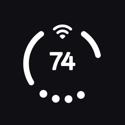
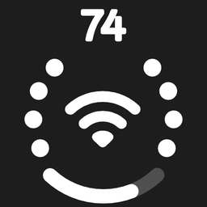
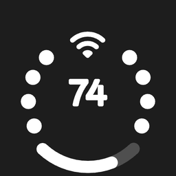

# Duo Status Bar

Duo Status Bar replaces the battery, Wi-Fi and mobile signal icons in your status bar with one clean,
animated indicator.

It is an LSPosed module. It does not modify system files. It only hides the icons it replaces and draws
the new indicator.

  

## Requirements

- Android 13 or newer.
- A custom ROM with root.
- LSPosed installed.

## Install

1. Download the APK from [Releases](https://github.com/kvmy666/duoStatusBar/releases) and install it.
2. Open LSPosed, go to Modules, and enable Duo Status Bar.
3. In the module's scope, tick **System UI**.
4. Restart System UI, or reboot the phone.
5. Open the Duo Status Bar app and turn the main switch on.

The module is off until you turn it on. Nothing changes before that.

## Supported UIs

| UI | Support |
| --- | --- |
| OnePlus OxygenOS 16 | ✅ Verified |
| Xiaomi HyperOS 3 | ✅ Verified |
| OPPO/realme ColorOS | ⚠️ Unverified |
| Samsung One UI | ⚠️ Unverified |
| vivo OriginOS | ⚠️ Unverified |
| Honor MagicOS | ⚠️ Unverified |
| Motorola MyOS | ⚠️ Unverified |
| Nothing OS | ⚠️ Unverified |

⚠️ = mapped in the module, but not yet verified on a device.

## Customization

| Default | Default · Invert center |
|:---:|:---:|
|  |  |
| **Two SIM** | **Two SIM · Invert center** |
|  |  |

Changing the size needs a System UI restart. The app has a button for it.

## PHDP integration

Duo can show download progress from PHDP on the ring.

1. Install [PHDP](https://github.com/hxreborn/punch-hole-download-progress/releases/latest).
2. In PHDP, open **System → Integrations** and choose **Duo**.
3. Start a download. Progress appears on the Duo ring.

## If something goes wrong

- Issues: https://github.com/kvmy666/duoStatusBar/issues
- Telegram: https://t.me/kvmy1

Send a report from the app's **About** section. It includes your device details and the logs, which
makes the problem much easier to find.

## Support

If you like the app, you can support the developer:
[Buy Me a Coffee](https://www.buymeacoffee.com/kroomfahd) or [PayPal](https://paypal.me/kroomfahd).

## License

GPL-3.0. See [LICENSE](LICENSE).
